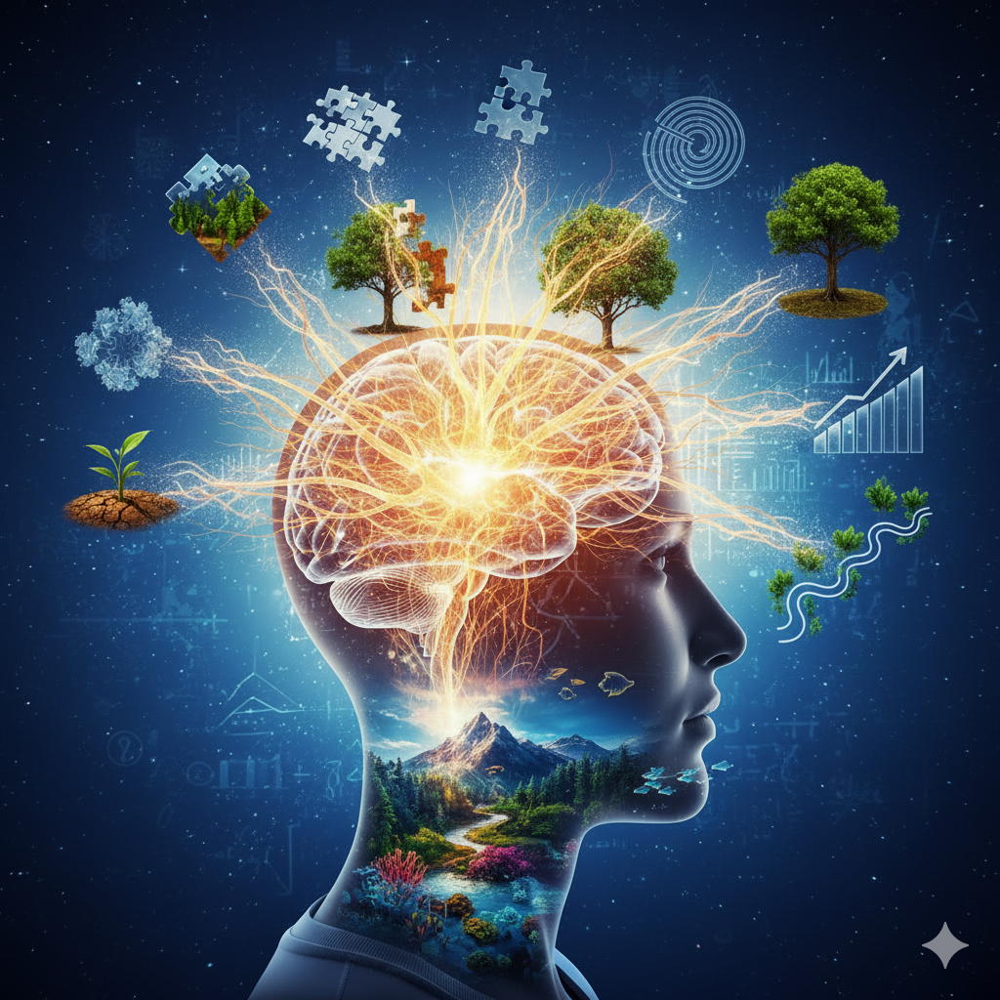

--- 
title: "Environmental Calculus - Active Learning with Case Studies"
author: "Gaj Sivandran"
date: "`r Sys.Date()`"
site: bookdown::bookdown_site
lang: en-US
output: bookdown::bs4_book
documentclass: book     
bibliography: [book.bib]  
biblio-style: apalike
link-citations: yes
github-repo: gajsivandran/Environmental_Calculus
description: "A textbook companion to the University of Washington QSci 291 class"
---

# Why Calculus?

A salmon run is building in a Pacific Northwest river. How fast are fish arriving at the counting station today? How many have passed since the run began? A wildfire is moving through dry forest. How fast is the fire line advancing right now? How much carbon has it released so far?

Those are the two questions calculus answers. How fast is something changing? How much has built up? Every chapter in this book comes back to one or the other.

Welcome to *Environmental Calculus*.

---

## Why This Book?

Most calculus textbooks are written for physics and engineering students. That makes sense. Calculus was invented to describe motion, and motion is easy to feel. We'll still use it when it helps.

But you're here to study oceans, rivers, forests, populations and the atmosphere, so that's where the examples come from: streamflow during a storm, CO₂ at Mauna Loa, contaminants moving through soil. If an example doesn't connect to something you could actually measure, I've tried to cut it.

I'm a hydrologist by training. I've spent my career using these tools on real water problems, and this book is my attempt to get you doing the same within the science you are pursuing. 

---

## What Is Calculus?

At its heart, calculus is the mathematics of **change** and **accumulation**. These two ideas appear in every branch of environmental science. Here are a few examples you'll encounter in this course:

| System | The Derivative (Rate of Change) | The Integral (Accumulation) |
|--------|--------------------------------|----------------------------|
| **Atmosphere** | How fast CO₂ concentration is rising right now | Total CO₂ added over a decade |
| **Populations** | The growth rate of a salmon population this season | Total fish that passed a weir over the run |
| **Hydrology** | How quickly streamflow is increasing during a storm | Total volume of water that flowed past a gauge |
| **Toxicology** | Rate at which a contaminant leaches into groundwater | Total mass of contaminant accumulated in soil |

Notice the pattern: a *derivative* tells you how fast something is changing at a specific moment; an *integral* tells you how much has piled up over time. These two ideas are deeply connected—in fact, the Fundamental Theorem of Calculus says they are two sides of the same coin. We'll get there step by step.

Traditionally, calculus uses physics examples like velocity (rate of change of position) and acceleration (rate of change of velocity). These are helpful because most of us can *feel* what it means to move faster or slower, so we'll use them when they make ideas clearer. But our main goal is always to connect calculus directly to the environment you are studying—population growth, forest carbon storage, water flow in rivers, and other natural systems.

We'll build your understanding step by step, supported by graphs, data, and hands-on examples. And if it's been a while since your last math class, that's completely okay—you'll find plenty of support here.

::: promptbox

**Change is Everywhere**

In a small group, discuss: where is *change* happening in this image? Try to identify at least three different processes. For each one, what might be changing, and how fast?

{fig.alt="A photograph of a natural river scene. Water flows through a channel bordered by green shrubs and grasses on the near bank. Tall deciduous and coniferous trees fill the background. A deer stands at the edge of the stream, lowering its head to drink. The scene illustrates multiple environmental processes happening simultaneously—water flow, plant growth, animal behavior, and nutrient cycling."}

:::

---

### Concept Check: Derivatives and Integrals {-}

See if you can identify which questions are about a *rate of change* (derivative) and which are about a *total accumulation* (integral).

**1. A researcher measures that a lake's pH is dropping by 0.03 units per year. Is this a derivative or an integral?**

<strong>Click to reveal answer</strong>

This is a **derivative** — it describes *how fast* the pH is changing at a given time (a rate of change per year).

**2. Over the past 50 years, atmospheric CO₂ has increased by about 100 ppm. Is this a derivative or an integral?**

<strong>Click to reveal answer</strong>

This is an **integral** — it describes *how much total change* has accumulated over a period of time. To get this number, you would need to add up all the small year-by-year increases.

**3. A stream gauge shows that 2.4 million cubic meters of water passed a monitoring station during March. Is this a derivative or an integral?**

<strong>Click to reveal answer</strong>

This is an **integral** — it describes the *total volume accumulated* over the month. The streamflow rate (cubic meters per second) at any given instant would be the derivative.

---

## How This Book Works

Each chapter is designed to support you as an active learner. Here's what you'll encounter:

**Explanations with environmental context.** Key concepts are introduced with clear language, supported by graphs and real data from ecological and earth science systems. We define terms carefully and build ideas step by step.

**Prompt boxes** are places to pause and think. Some ask you to discuss with a partner, some ask you to sketch or write, and some pose a question to wrestle with before reading on. They look like this:

::: promptbox
**Example Prompt**

This is where you'll find a question or activity. The write-in space below is for your notes.

:::

**Concept checks** appear throughout each chapter. These are low-stakes questions with click-to-reveal answers so you can immediately test whether a concept has clicked. If you get one wrong, that's useful information—go back and re-read the section, or bring the question to class.

**Worked examples** walk through environmental problems step by step, showing not just the math but the reasoning: *what* we're doing, *why*, and *what the answer means in context*.

**Workbook chapters** follow each content chapter. These give you space for guided practice, with prompts, write-in areas, and additional problems to work through at your own pace.

---

## Success in This Class

{fig.alt="Artistic illustration of a human head in profile with a glowing brain at the center. Branching connections extend outward from the brain to various environmental elements including trees, clouds, water, and landscapes, symbolizing connections between human thinking and natural systems. Additional icons such as graphs, waves, and molecules are faintly visible in the background, suggesting links between cognition, data, and environmental processes."}

First and foremost, know this: **we believe in your ability to learn and grow.** You bring unique strengths and perspectives, and your effort matters here.

Mistakes are not a setback—they are the very heart of learning. When you get something wrong, you uncover where your thinking needs refinement, and that creates the space for real growth. Struggle is not a sign you don't belong; it's proof that your brain is stretching and building new connections.

Just like in science, learning calculus is about **iteration**—trying, testing, revising, and improving. That process is what makes your understanding deeper and more durable.

Assessments in this class are snapshots of your thinking at a particular moment in time. They are not final judgments about your intelligence, your worth, or your potential. You will have chances to revisit concepts, refine your understanding, and demonstrate what you've learned. Growth comes from re-engaging with the material, not from perfection on the first try.

So give yourself permission to be imperfect. Keep engaging, reflecting, and asking questions. We'll be here to support you every step of the way.

---

## Looking Ahead

By the end of this course, you will be able to:

- **Interpret derivatives** as rates of change in systems like population dynamics, streamflow, and atmospheric chemistry  
- **Use differentiation rules** to analyze how environmental quantities respond to changing conditions  
- **Find and interpret extrema** to identify tipping points, optimal strategies, and critical thresholds in ecological systems  
- **Read and create graphs** that communicate environmental trends with mathematical precision  
- **Set up and solve applied problems** using real data from the environmental sciences  

But even more important than any specific skill, you'll leave this course with a stronger belief in your ability to *learn mathematics*—and the confidence to keep growing, using math as a tool to explore, protect, and better understand the natural world around you.

---

## About This Book

I started writing this textbook to create a calculus resource that speaks directly to your interests as environmental scientists. My goal is to make calculus feel relevant, supportive, and connected to the systems you care about.

That said, this is very much a **work in progress**. This draft will have typos, rough edges, and the occasional mistake. But here's the good news: it's also **free**.

If you come across an error—big or small—please let me know so I can fix it for you and for future students. Your feedback is not just welcome, it's essential to making this a better resource.

Thanks for your patience, your sharp eyes, and your willingness to learn from (and with) an evolving text. Together, we'll keep improving it. 

## AI Transparency

I developed this book for students in my quantitative science courses at UW. I ask those students to be open about how they use AI, so the same standard applies to me.

The course design is mine: what we cover, in what order, the environmental case studies, and how each idea is explained. 

I used generative AI tools to:

- edit for grammar and consistency. 
- draft practice problems, concept checks and their worked solutions
- format and convert material, including the reveal-answer blocks and the study guides
- meet digital accessibility requirements (WCAG 2.1 AA): drafting alt text for figures, checking heading structure, color contrast and table markup, and producing accessible Word versions of course documents

I reviewed and edited all AI-generated material before publishing.

